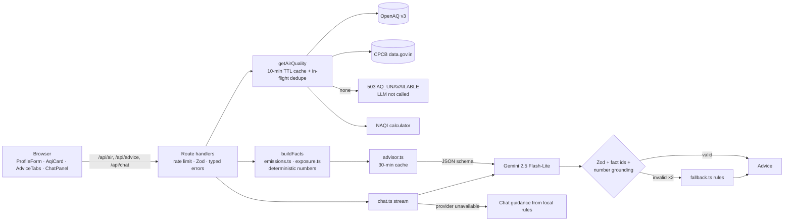

# SmogSense

**A GenAI air-quality assistant for Indian cities in winter smog. It is grounded on live OpenAQ / CPCB data and never on guesses.**

Built for PromptWars Virtual Challenge 6 (Google × Hack2skill).

**Live demo:** [smogsense-zeta.vercel.app](https://smogsense-zeta.vercel.app)

## Problem

Every winter, AQI in Delhi, Lucknow, Patna, Kolkata and many other cities goes past 300. Generic advice like "stay indoors" doesn't help people decide **when** to commute, **how** to keep a child's bedroom clean, or **which** greener choice actually matters. SmogSense turns the live station reading plus your household into a plan. Every recommendation says **why** and gives a concrete, computed **impact**.

## Features mapped to the problem statement

| PS requirement | Feature | Code |
|---|---|---|
| Real-time AQI only from public APIs | Nearest fresh reference monitor across OpenAQ and CPCB. CPCB supplies the published AQI when both feeds report the selected station. If neither answers, the UI shows "Live data unavailable" and the LLM is never called | `src/lib/aq/openaq.ts`, `src/lib/aq/cpcb.ts`, `src/lib/aq/index.ts` |
| Indian AQI | CPCB National AQI sub-indices and categories, plus the official health statements | `src/lib/aq/naqi.ts` |
| Low-emission daily routines | Commute mode exposure comparison, best outdoor window, N95 guidance, indoor exercise | `src/lib/impact/facts.ts` (routines) |
| Trip timing from live AQI | Cleanest and dirtiest 3-hour windows computed from the station's own measured last 24 h of PM2.5 (a documented default when no history exists). Severe → avoid exertion. Warns when your work start is in the dirtiest window | `src/lib/impact/timing.ts`, `src/lib/ai/fallback.ts` |
| Indoor air hacks | Purifier (own / HEPA / DIY by budget), ventilation timing, cooking exhaust, indoor smoke, an honest note on plants | `facts.ts` (indoor) |
| Sustainable alternatives + impact | Transit switch, carpool, WFH day, active short trips, no open burning, each with kg CO₂/week or g PM2.5 | `src/lib/impact/emissions.ts` |
| Every item states WHY + IMPACT | Schema enforces `{action, why, impact, personalizedFor, priority}` | `src/lib/ai/schema.ts` |
| Personalisation | Location (city or GPS), kids, elderly, respiratory sensitivity, pets, commute mode and distance, work hours, purifier, budget | `src/lib/profile.ts`, `src/components/ProfileForm.tsx` |
| GenAI | Gemini 2.5 Flash-Lite personalises and prioritises with structured JSON. Streamed follow-up chat. English and Hindi UI, advice and chat (`src/lib/i18n.ts`) | `src/lib/ai/advisor.ts`, `src/lib/ai/chat.ts` |

## Architecture



## Data sources

- **OpenAQ v3.** The adapter searches within 25 km for `isMonitor=true` locations first, then checks low-cost sensors if no reference monitor has usable particulate data. It pages through location results, drops offline sites and checks the nearest candidates in batches of three. The API reports `sensorType` and the card labels a low-cost sensor when used. Sites often expose duplicate sensors for one pollutant (µg/m³ and ppb), so the freshest valid one wins. Gas units are converted to µg/m³ at 25 °C. Hourly history for the chosen station supplies 24-hour means for PM2.5, PM10, NO₂, SO₂ and NH₃ (at least 16 valid hours), and the peak complete rolling 8-hour mean in the past 24 hours for CO and O₃. A pollutant with insufficient history uses its latest value and makes the AQI provisional. The card shows the latest hourly PM2.5 and its timestamp separately. PM2.5 history also drives the timing advice. [CPCB National AQI report](https://app.cpcbccr.com/ccr_docs/FINAL-REPORT_AQI_.pdf)
- **CPCB real-time AQI** via data.gov.in resource `3b01bcb8-0b14-4abf-b6f2-c1bfd384ba69`, filtered by city. Verified live: `avg_value` is the pollutant's **NAQI sub-index**, not a concentration, so we use it directly. `"NA"` values are skipped and timestamps are parsed as IST. SmogSense selects the nearer fresh reference monitor when CPCB and OpenAQ report different stations. A fresh CPCB monitor takes precedence over a low-cost sensor or a stale OpenAQ reading. A same-station match retains the hourly OpenAQ PM2.5 data when available. A CPCB-only station can supply AQI while hourly PM2.5 is unavailable. [CPCB feed on data.gov.in](https://www.data.gov.in/resource/real-time-air-quality-index-various-locations)
- Readings at least 3 h old are flagged **stale**; readings older than 24 h or timestamped in the future are rejected.
- Impact factors and their citations are in `src/lib/constants.ts` (India GHG Program 2015, Goel et al. 2015, US EPA Exposure Factors Handbook 2011 Table 6-2, Nazaroff 2004, UC Davis DIY air cleaner study 2021, Singer et al. 2012, Liu et al. 2003, Akagi et al. 2011, Cummings & Waring 2020).

## Verified against live APIs

`npm run smoke:live -- --no-ai` compares OpenAQ and CPCB directly. `BASE_URL=https://smogsense-zeta.vercel.app npm run smoke:live -- --no-ai` checks the deployed air route. Omit the flag to include advice and chat.

On 22 Nov 2026 at 22:08 IST, the direct smoke test found these readings.

| City | OpenAQ reference monitor | CPCB reference monitor | Selected AQI |
|---|---|---|---:|
| Delhi | Lodhi Road, 141 (2.6 km) | Talkatora Garden, 286 (2.0 km) | 286 (CPCB) |
| Mumbai | Mumbai, India, 264 (0.4 km) | Bandra Kurla Complex, 143 (1.9 km) | 264 (OpenAQ) |
| Bengaluru | Hombegowda Nagar, 185 (3.5 km) | Hombegowda Nagar, 184 (3.5 km) | 184 (CPCB) |

Mumbai's two reference monitors report different stations and measurement times. The app selects the nearer monitor. Bengaluru compares the same station and uses CPCB's published sub-indices.

The production smoke test with `--no-ai` passed for all three cities and returned the selected AQI values in the table.

API integration tests simulate Gemini HTTP 429 and 503. Chat responds with HTTP 200 and guidance grounded in the station reading and household facts. Browser tests mock advice and chat and check that the homepage makes zero calls to either route on load.

## Lighthouse

Lighthouse 13.6.0 audited the production homepage on 22 Nov 2026.

| Profile | Performance | Accessibility | Best Practices | SEO |
|---|---:|---:|---:|---:|
| Mobile | 100 | 100 | 100 | 100 |
| Desktop | 100 | 100 | 100 | 100 |

## How the AI is grounded (no hallucinated AQI)

1. **No data, no AI.** `/api/advice` and `/api/chat` call `getAirQuality` first. If every source fails, they return 503 before any model call.
2. **Code computes, the LLM explains.** `buildFacts()` creates every recommendation with its impact number computed deterministically (kg CO₂, % exposure, purifier mass balance). Gemini only rephrases, personalises and prioritises these facts, and references each one by `factId`.
3. **The impact is always ours.** Facts are generated in the requested language by code (a test checks English and Hindi carry identical numbers), and the computed `impact` string is always used verbatim.
4. **Number guard.** Any number in the model's summary, action or why text that doesn't appear in the grounded context causes the output to be rejected. It then retries once, and after that uses the rule-based fallback. The fallback works with zero AI.
5. **Chat** uses the server-fetched snapshot and facts. User text is delimited and capped at 500 characters. If Gemini is unavailable or fails mid-stream, chat returns HTTP 200 with a notice and keyword-matched guidance from those facts.
6. **User-initiated and cached.** Loading the homepage makes zero Gemini requests. The advice cache allows one model attempt per station, NAQI category, profile and language for 30 minutes, with a retry for invalid model output. If the grounded details change within a band, the app rebuilds the advice from current facts.

## Judging criteria evidence

| Criterion | Evidence |
|---|---|
| **Code quality** | TypeScript `strict` + `noUncheckedIndexedAccess`, no `any` (lint rule set to error). One responsibility per file, every file under 200 lines, pure functions in `src/lib`, typed errors (`src/lib/errors.ts`), JSDoc on exports, every constant sourced in `src/lib/constants.ts`. ESLint runs with `--max-warnings 0` |
| **Security** | [SECURITY.md](SECURITY.md) threat model. `server-only` key modules, Zod env + body validation, lat/lon bounds, a 500-char chat cap, a 16 KB body cap, per-IP token bucket (429), CSP / XFO / nosniff / Referrer / Permissions-Policy / HSTS headers, no stack traces in responses, `npm audit` clean |
| **Efficiency** | AQ cache 10 min (keyed by lat/lon at 2 dp) and advice cache 30 min, both with in-flight dedupe (`src/lib/cache.ts`). Parallel station fetches, 5 s `AbortSignal` timeouts, `maxOutputTokens` caps, `thinkingBudget: 0`. Server Components by default, chat panel loaded with `next/dynamic`, streamed chat. SVG interface icons, system fonts. 114 kB first-load JS, standalone output |
| **Testing** | Vitest covers unit, integration and component suites. Coverage thresholds of 80% are enforced on `src/lib`. Every NAQI category edge, real captured OpenAQ/CPCB/Gemini fixtures, the source fallback order, the stale flag, advisor retry → fallback, the hallucination guard, and each route's 200/400/429/503/500 path are covered. vitest-axe runs on the components. Playwright E2E covers onboarding → AQI → 3 tabs → chat, with axe WCAG 2.1 AA scans. CI runs all of it (`.github/workflows/ci.yml`) |
| **Accessibility** | `lang` attribute (plus `lang="hi"` on Hindi content), skip link, landmarks, a single h1 with ordered headings, labelled inputs, errors linked through `aria-describedby` and `aria-invalid`, WAI-ARIA tabs with arrow/Home/End keys, a visible focus ring, `aria-live` for the AQI card and streamed chat. The category is shown as text plus a distinct icon shape, not colour alone. 44 px targets, `prefers-reduced-motion` respected. Zero axe violations in unit and E2E tests |
| **Problem statement alignment** | See the feature table above: live public AQI only, the Indian NAQI, routines, timing, indoor hacks and alternatives, each with why, impact and personalisation, plus English/Hindi |

## Setup

```bash
npm ci
cp .env.example .env.local   # add OPENAQ_API_KEY, DATA_GOV_IN_API_KEY, GEMINI_API_KEY
npm run dev                  # http://localhost:3000
```

All keys are optional individually. You need at least one AQ key (OpenAQ or data.gov.in) for live data. Without `GEMINI_API_KEY`, advice and chat use the same deterministic facts. Set `GEMINI_MODEL` to override the default `gemini-2.5-flash-lite`.

## Test

```bash
npm run lint && npm run typecheck
npm run test:coverage        # unit + integration + component, thresholds enforced
npm run build && npx playwright install chromium && npm run test:e2e
```

## Deploy to Vercel Hobby

Link this directory with `vercel link --yes --project smogsense`. Add `OPENAQ_API_KEY`, `DATA_GOV_IN_API_KEY` and `GEMINI_API_KEY` as encrypted Production and Preview environment variables, then release with `vercel --prod`. The Node.js functions use Mumbai (`bom1`), and `/api/advice` has a 30-second limit. [Vercel environment variables](https://vercel.com/docs/environment-variables)

The multi-stage Dockerfile provides a portable non-root build on port 8080.
