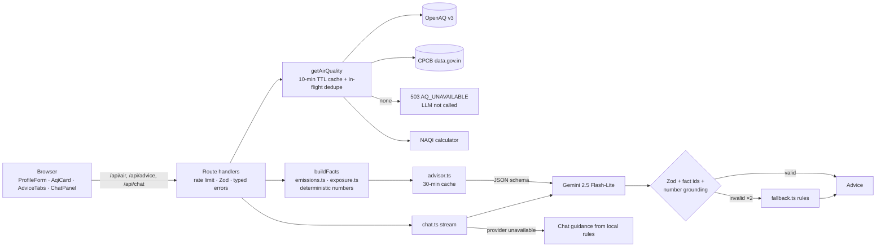

# SmogSense

**A GenAI air-quality assistant for Indian cities in winter smog. It is grounded on live OpenAQ / CPCB data and never on guesses.**

Built for PromptWars Virtual Challenge 6 (Google × Hack2skill).

**Live demo:** [smogsense-zeta.vercel.app](https://smogsense-zeta.vercel.app)

## Problem

Every winter, AQI in Delhi, Lucknow, Patna, Kolkata and many other cities goes past 300. Generic advice like "stay indoors" doesn't help people decide **when** to commute, **how** to keep a child's bedroom clean, or **which** greener choice actually matters. SmogSense turns the live station reading plus your household into a plan. Every recommendation says **why** and gives a concrete, computed **impact**.

## Features mapped to the problem statement

| PS requirement | Feature | Code |
|---|---|---|
| Real-time AQI only from public APIs | Nearest fresh reference monitor across OpenAQ and CPCB. CPCB supplies the published AQI when both feeds report the selected station. If neither answers, the UI shows "Live data unavailable" and the LLM is never called | `src/lib/aq/openaq.ts`, `src/lib/aq/cpcb.ts`, `src/lib/aq/index.ts` |
| Indian AQI | CPCB National AQI sub-indices and categories, plus the official health statements | `src/lib/aq/naqi.ts` |
| Low-emission daily routines | Commute mode exposure comparison, best outdoor window, N95 guidance, indoor exercise | `src/lib/impact/facts.ts` (routines) |
| Trip timing from live AQI | Cleanest and dirtiest 3-hour windows computed from the station's own measured last 24 h of PM2.5 (a documented default when no history exists). Severe → avoid exertion. Warns when your work start is in the dirtiest window | `src/lib/impact/timing.ts`, `src/lib/ai/fallback.ts` |
| Indoor air hacks | Purifier (own / HEPA / DIY by budget), ventilation timing, cooking exhaust, indoor smoke, an honest note on plants | `facts.ts` (indoor) |
| Sustainable alternatives + impact | Transit switch, carpool, WFH day, active short trips, no open burning, each with kg CO₂/week or g PM2.5 | `src/lib/impact/emissions.ts` |
| Every item states WHY + IMPACT | Schema enforces `{action, why, impact, personalizedFor, priority}` | `src/lib/ai/schema.ts` |
| Personalisation | Location (city or GPS), kids, elderly, respiratory sensitivity, pets, commute mode and distance, work hours, purifier, budget | `src/lib/profile.ts`, `src/components/ProfileForm.tsx` |
| GenAI | Gemini 2.5 Flash-Lite personalises and prioritises with structured JSON. Streamed follow-up chat. English and Hindi UI, advice and chat (`src/lib/i18n.ts`) | `src/lib/ai/advisor.ts`, `src/lib/ai/chat.ts` |
| Daily guidance in one line | "Today in one line" (window, windows, mask), Gemini-reworded with a computed fallback | `src/features/today/` |
| Know what to wear | Cited mask guide by AQI band and activity, with a children note | `src/features/mask/` |
| Indoor air hacks, made doable | Daily household checklist with Why and Impact | `src/features/checklist/` |
| Plan ahead | 48 h model forecast and the cleanest windows (clearly labelled as a forecast) | `src/features/outlook/` |
| Where to live / work | Compare air quality at two places | `src/features/compare/` |
| Impact of choices over time | Commute tracker: CO₂ and PM2.5 avoided vs your usual mode | `src/features/tracker/` |
| Stay informed | Threshold alerts while the app is open, installable as a PWA | `src/features/alerts/` |
| Families | Kid-friendly wording with identical numbers | `src/features/kids/` |
| Improve the advice | Anonymous helpful / not-useful votes | `src/features/feedback/` |
| Spread awareness | Shareable image cards (English and Hindi) | `src/features/share/` |

## Architecture



## Data sources

- **OpenAQ v3.** The adapter searches within 25 km for `isMonitor=true` locations first, then checks low-cost sensors if no reference monitor has usable particulate data. It pages through location results, drops offline sites and checks the nearest candidates in batches of three. The API reports `sensorType` and the card labels a low-cost sensor when used. Sites often expose duplicate sensors for one pollutant (µg/m³ and ppb), so the freshest valid one wins. Gas units are converted to µg/m³ at 25 °C. Hourly history for the chosen station supplies 24-hour means for PM2.5, PM10, NO₂, SO₂ and NH₃ (at least 16 valid hours), and the peak complete rolling 8-hour mean in the past 24 hours for CO and O₃. A pollutant with insufficient history uses its latest value and makes the AQI provisional. The card shows the latest hourly PM2.5 and its timestamp separately. PM2.5 history also drives the timing advice. [CPCB National AQI report](https://app.cpcbccr.com/ccr_docs/FINAL-REPORT_AQI_.pdf)
- **CPCB real-time AQI** via data.gov.in resource `3b01bcb8-0b14-4abf-b6f2-c1bfd384ba69`, filtered by city. Verified live: `avg_value` is the pollutant's **NAQI sub-index**, not a concentration, so we use it directly. `"NA"` values are skipped and timestamps are parsed as IST. SmogSense selects the nearer fresh reference monitor when CPCB and OpenAQ report different stations. A fresh CPCB monitor takes precedence over a low-cost sensor or a stale OpenAQ reading. A same-station match retains the hourly OpenAQ PM2.5 data when available. A CPCB-only station can supply AQI while hourly PM2.5 is unavailable. [CPCB feed on data.gov.in](https://www.data.gov.in/resource/real-time-air-quality-index-various-locations)
- Readings at least 3 h old are flagged **stale**; readings older than 24 h or timestamped in the future are rejected.
- Impact factors and their citations are in `src/lib/constants.ts` (India GHG Program 2015, Goel et al. 2015, US EPA Exposure Factors Handbook 2011 Table 6-2, Nazaroff 2004, UC Davis DIY air cleaner study 2021, Singer et al. 2012, Liu et al. 2003, Akagi et al. 2011, Cummings & Waring 2020).

## Verified against live APIs

`npm run smoke:live -- --no-ai` compares OpenAQ and CPCB directly. `BASE_URL=https://smogsense-zeta.vercel.app npm run smoke:live -- --no-ai` checks the deployed air route. Omit the flag to include advice and chat.

On 22 Nov 2026 at 22:08 IST, the direct smoke test found these readings.

| City | OpenAQ reference monitor | CPCB reference monitor | Selected AQI |
|---|---|---|---:|
| Delhi | Lodhi Road, 141 (2.6 km) | Talkatora Garden, 286 (2.0 km) | 286 (CPCB) |
| Mumbai | Mumbai, India, 264 (0.4 km) | Bandra Kurla Complex, 143 (1.9 km) | 264 (OpenAQ) |
| Bengaluru | Hombegowda Nagar, 185 (3.5 km) | Hombegowda Nagar, 184 (3.5 km) | 184 (CPCB) |

Mumbai's two reference monitors report different stations and measurement times. The app selects the nearer monitor. Bengaluru compares the same station and uses CPCB's published sub-indices.

The production smoke test with `--no-ai` passed for all three cities and returned the selected AQI values in the table.

API integration tests simulate Gemini HTTP 429 and 503. Chat responds with HTTP 200 and guidance grounded in the station reading and household facts. Browser tests mock advice and chat and check that the homepage makes zero calls to either route on load.

## Lighthouse

Lighthouse 13.6.0 audited the production homepage on 22 Nov 2026.

| Profile | Performance | Accessibility | Best Practices | SEO |
|---|---:|---:|---:|---:|
| Mobile | 100 | 100 | 100 | 100 |
| Desktop | 100 | 100 | 100 | 100 |

**v2 build** (all ten features), audited on 23 Nov 2026 against a local production build of the same commit, because Vercel preview deployments sit behind a login: Performance 100 / Accessibility 100 / Best Practices 100 / SEO 100 on both mobile and desktop (FCP 0.8 s, LCP 0.8 s, TBT 20 ms, CLS 0 on mobile). First-load JS is 120 kB: every new section is a lazy chunk. An earlier v2 build scored 96 on Best Practices because Zod 4 probes for `new Function`, which our CSP forbids and Chrome logs as an issue; client code now uses a Zod copy with JIT off (`src/features/shared/zod.ts`, with a test that keeps it that way). Chrome's issue log and console were also clean across the full flow (submit, forecast, compare, alerts, tracker, share).

## How the AI is grounded (no hallucinated AQI)

1. **No data, no AI.** `/api/advice` and `/api/chat` call `getAirQuality` first. If every source fails, they return 503 before any model call.
2. **Code computes, the LLM explains.** `buildFacts()` creates every recommendation with its impact number computed deterministically (kg CO₂, % exposure, purifier mass balance). Gemini only rephrases, personalises and prioritises these facts, and references each one by `factId`.
3. **The impact is always ours.** Facts are generated in the requested language by code (a test checks English and Hindi carry identical numbers), and the computed `impact` string is always used verbatim.
4. **Number guard.** Any number in the model's summary, action or why text that doesn't appear in the grounded context causes the output to be rejected. It then retries once, and after that uses the rule-based fallback. The fallback works with zero AI.
5. **Chat** uses the server-fetched snapshot and facts. User text is delimited and capped at 500 characters. If Gemini is unavailable or fails mid-stream, chat returns HTTP 200 with a notice and keyword-matched guidance from those facts.
6. **User-initiated and cached.** Loading the homepage makes zero Gemini requests. The advice cache allows one model attempt per station, NAQI category, profile and language for 30 minutes, with a retry for invalid model output. If the grounded details change within a band, the app rebuilds the advice from current facts.
7. **Model failover and visible fallback reasons.** `src/lib/ai/client.ts` tries `gemini-2.5-flash`, then `gemini-3.5-flash-lite` (a 404 retired-model or 429 quota error moves on to the next model; `GEMINI_MODEL` overrides the first). Every fallback to rules logs a reason code (`quota|auth|model|schema|timeout|other`, never the provider message) and `/api/advice` returns it as `fallbackReason`, so the UI says "Rule-based plan (AI busy (quota))" instead of a vague "AI unavailable". A failed attempt is not cached beyond a 60 s cooldown.

## UI (v2 redesign)

The page is an app shell with five deep-linkable sections (`#today`, `#plan`, `#routes`, `#outlook`, `#me`; the back button works): **Today** (AQI hero with 24 h PM2.5 sparkline, one-line summary, mask guide, household checklist), **Plan** (Gemini plan, kid mode, tip feedback, share card), **Routes**, **Outlook** (48 h forecast, compare) and **Me** (profile, tracker, alerts, language, light/dark). First visit shows a short onboarding (city + household); returning visitors get their saved household and a fresh live reading, and the plan (the only Gemini call) is requested when Plan opens. A floating **Ask** button opens the chat in a native modal dialog on every section. Navigation is a bottom tab bar on mobile and a sidebar from 1024 px.

Design tokens live in one place (`src/design/tokens.ts` → Tailwind plugin → CSS variables) for light, dark and the six CPCB categories (accents darkened to pass AA; category is always icon + text, never colour alone; `tests/unit/design-contrast.test.ts` enforces the ratios). Shared primitives are in `src/components/ui`. Playwright checks 320, 768, 1280 px and 200 % zoom in light and dark (axe, no sideways scroll) and saves screenshots to `screenshots/` (git-ignored artifacts; no pixel comparison). Redesign build, local production build: Lighthouse mobile 92/100/100/100 (CLS 0.006), desktop 100/100/100/100 (CLS 0.027); first-load JS for `/` is 126 kB.

## Routes: breathe the least on the way (v2)

`POST /api/route` takes an origin and a destination (place names, geocoded by Nominatim, or exact coordinates) and returns routes for walking, cycling, two-wheeler and car, ranked by **estimated** PM2.5 inhaled, not just speed.

- **Routes:** OSRM `alternatives=true` per mode (FOSSGIS public servers: foot, bike, car). OSRM has no motorcycle profile, so two-wheelers use the car road network and car travel times. No transit: there is no real timetable source, so none is invented.
- **Exposure (computed in code, `src/lib/route/exposure.ts`):** ambient PM2.5 × road factor × in-mode ratio (Goel et al. 2015) × breathing rate (EPA EFH Table 6-2) × hours. Ambient PM2.5 comes from the nearest fresh reference monitor's last-24 h profile **at the time of day you travel** (hours the trip passes through are weighted by minutes).
- **"Approximate" flag:** set when no monitor is within 25 km of the start (the city-level reading is used instead), when the station distance is unknown, or when the value is inferred from a CPCB sub-index. The UI always says exposure is estimated, never measured.
- **Road-type adjustment:** applied only to the share of a route that OSRM marks with a road `ref` or a major class (factor and sources in `src/lib/route/constants.ts`). Live responses expose very few, so most routes show "not applied (OSRM gave no road class)" instead of a guess.
- **Labels:** *Cleanest air* (lowest estimated PM2.5 inhaled), *Fastest* (lowest duration), *Best balance* (lowest sum of the two ranks). Ties are broken deterministically; a single candidate holds all three labels. Each card shows duration, distance, estimated PM2.5 inhaled (µg), estimated CO₂ (kg) and a one-line reason.
- **Reasons:** Gemini only rewords the computed sentence. A reason with a number outside the computed context, or that calls the estimate "measured", is rejected and the computed sentence is kept (`src/lib/route/reasonsAi.ts`).
- **Typed errors:** 400 invalid input (bad coordinates, same place, more than 60 km apart, departure outside the next 24 h), 404 `PLACE_NOT_FOUND`, 503 `GEOCODE_UNAVAILABLE` / `ROUTE_UNAVAILABLE` / `AQ_UNAVAILABLE`. Nominatim calls are serialised to 1 per second per its usage policy and cached for 24 h.

## v2 features

Every feature lives in `src/features/<name>/` (pure `logic.ts`, typed English + Hindi `strings.ts`, a component) and is loaded lazily below the fold. Numbers are computed in code; Gemini only rewords. Per-user state is `localStorage` only (see "Per-device data").

| Feature | What it does | Honest limits |
|---|---|---|
| **Today in one line** (`today`) | One sentence at the top: best outdoor window, windows open/shut, mask yes/no, computed from the live reading and household. Gemini may reword it in the existing advice call (no extra request); it is accepted only if both times and any shut-windows/mask decision survive, else the computed sentence is shown | The window is the station's measured last 24 h; without history it is a documented afternoon default and says "usually" |
| **Mask guide** (`mask`) | What to wear by AQI band and activity, with fit tips and sources: the MoHFW *Advisory on Air Pollution and Health* (18 Nov 2024: close-fitted N95/N99 when AQI > 200; paper, cloth, handkerchief and scarf are not effective) and NIOSH (no respirator is approved for children; beards break the seal) | The advisory has no "surgical mask" tier, so none is offered. General information, not medical advice |
| **Household checklist** (`checklist`) | Today's indoor actions from the computed facts, each with Why and Impact; incense/coils only above AQI 200; purifier owners get a filter check. Tick them off; resets at midnight IST | Saved on this device only |
| **48 h outlook** (`outlook`) | Open-Meteo / CAMS forecast PM2.5, the three cleanest waking-hour windows, an SVG chart with a text alternative and an hourly table. Cached 1 h | A coarse model forecast, labelled "not a measurement"; can differ from stations. Categories use PM2.5 alone, so they are not an official AQI |
| **Compare two places** (`compare`) | Two cities or typed places (Nominatim) side by side: AQI, category, dominant pollutant, best window. Each side resolves alone, so one failure never hides the other | Place search is limited to 1 request/second |
| **Commute impact tracker** (`tracker`) | Log trips (manually, or "Log this trip" from the route planner); weekly/monthly CO₂ and PM2.5 avoided vs your usual mode; CSV export; two-step clear | Estimates (average emission factors and a trip-dose model). Device-only; no sync |
| **Air alerts** (`alerts`) | Pick a city and AQI level; an in-app banner and a browser notification when it is reached. Installable as a PWA (manifest, icons, a minimal no-caching service worker so Android notifications work) | **Only works while SmogSense is open** (a tab or the installed app). There is no background push: that needs a server that stores subscriptions, which SmogSense deliberately does not have. Permission is requested only from a button. The banner is static (no animation) |
| **Kid-friendly mode** (`kids`) | Simpler wording for routine and indoor tips when the household has children. A second implementation of the same copy interface receives the same numeric arguments, so every number is identical (a test proves it, in both languages). Gemini rewrites on request; the kid templates are the fallback | Greener-choice tips keep the standard wording. The kid wording never tells a child to wear an N95 |
| **Tip feedback** (`feedback`) | Helpful / Not useful on every tip; saved on the device and sent as `{tipId, vote}` only | The server writes one anonymous log line per vote; it is a log, not an analytics database (short retention on Vercel Hobby). See SECURITY.md |
| **Shareable card** (`share`) | `/api/card` renders a 1200×630 PNG with `next/og`: today's air for a city (recomputed on the server from the live reading, so it cannot be forged) or your own impact (bounded, strictly validated numbers, labelled self-reported). Web Share with a download fallback | Hindi uses a bundled, subsetted Noto Sans Devanagari (SIL OFL). The image renderer does not reorder the short-i vowel sign, so a small tested step does it; conjuncts are drawn with a visible virama (readable, not typographically perfect). No Open Graph tags are set on the site itself |

### Per-device data

Checklist ticks, the trip log, alert settings, compare choices, tip votes and the kid-mode preference are stored in this browser's `localStorage` (keys `smogsense:v1:*`): no accounts, no database, nothing synced. Every read is validated, so corrupt or blocked storage falls back to defaults instead of crashing. Clearing site data removes it. The tracker can export a CSV first.

## Judging criteria evidence

| Criterion | Evidence |
|---|---|
| **Code quality** | TypeScript `strict` + `noUncheckedIndexedAccess`, no `any` (lint rule set to error). One responsibility per file, every file under 200 lines, pure functions in `src/lib`, typed errors (`src/lib/errors.ts`), JSDoc on exports, every constant sourced in `src/lib/constants.ts`. ESLint runs with `--max-warnings 0` Each v2 feature is a self-contained folder (`logic` / `strings` / component), every file stays under 200 lines, and a parity test keeps every English and Hindi dictionary in step. |
| **Security** | [SECURITY.md](SECURITY.md) threat model. `server-only` key modules, Zod env + body validation, lat/lon bounds, a 500-char chat cap, a 16 KB body cap, per-IP token bucket (429), CSP / XFO / nosniff / Referrer / Permissions-Policy / HSTS headers, no stack traces in responses, `npm audit` clean v2: the feedback endpoint is strict, takes `tipId` from a closed list that a test ties to `buildFacts`, and logs no IP, user agent or profile; the share-card query is strict and bounded; localStorage reads are Zod-validated; notification permission is requested only from a button; no new CSP origins. |
| **Efficiency** | AQ cache 10 min (keyed by lat/lon at 2 dp) and advice cache 30 min, both with in-flight dedupe (`src/lib/cache.ts`). Parallel station fetches, 5 s `AbortSignal` timeouts, `maxOutputTokens` caps, `thinkingBudget: 0`. Server Components by default, chat panel loaded with `next/dynamic`, streamed chat. SVG interface icons, system fonts. 114 kB first-load JS, standalone output v2: every new section is a lazy chunk (first-load JS 120 kB), Zod is kept out of first-load code, the forecast is cached 1 h and the shared "today" card 10 min, and Gemini adds no extra call for the one-liner. |
| **Testing** | Vitest covers unit, integration and component suites. Coverage thresholds of 80% are enforced on `src/lib`. Every NAQI category edge, real captured OpenAQ/CPCB/Gemini fixtures, the source fallback order, the stale flag, advisor retry → fallback, the hallucination guard, and each route's 200/400/429/503/500 path are covered. vitest-axe runs on the components. Playwright E2E covers onboarding → AQI → 3 tabs → chat, with axe WCAG 2.1 AA scans. CI runs all of it (`.github/workflows/ci.yml`) v2: 647 tests (58 files); coverage on `src/lib` and the feature logic is 98.11% lines / 90.53% branches against an 80% gate; a real-PNG render test covers the share card; an e2e "v2 feature smoke" has one step per feature, plus PWA-asset and card-API tests. |
| **Accessibility** | `lang` attribute (plus `lang="hi"` on Hindi content), skip link, landmarks, a single h1 with ordered headings, labelled inputs, errors linked through `aria-describedby` and `aria-invalid`, WAI-ARIA tabs with arrow/Home/End keys, a visible focus ring, `aria-live` for the AQI card and streamed chat. The category is shown as text plus a distinct icon shape, not colour alone. 44 px targets, `prefers-reduced-motion` respected. Zero axe violations in unit and E2E tests v2: every new component has an axe test in English and Hindi; the forecast chart has a title, description and hourly table; the alerts toggle uses a constant label with `aria-pressed`; the alert banner is static; share previews have descriptive alt text; storage and permission failures are handled in the UI. |
| **Problem statement alignment** | See the feature table above: live public AQI only, the Indian NAQI, routines, timing, indoor hacks and alternatives, each with why, impact and personalisation, plus English/Hindi v2 adds daily one-line guidance, a cited mask guide, a household checklist, a 48 h outlook, place comparison, impact tracking, alerts, kid-friendly wording, feedback and shareable cards (see "v2 features"). |

## Setup

```bash
npm ci
cp .env.example .env.local   # add OPENAQ_API_KEY, DATA_GOV_IN_API_KEY, GEMINI_API_KEY
npm run dev                  # http://localhost:3000
```

All keys are optional individually. You need at least one AQ key (OpenAQ or data.gov.in) for live data. Without `GEMINI_API_KEY`, advice and chat use the same deterministic facts. Set `GEMINI_MODEL` to override the default `gemini-2.5-flash-lite`.

## Test

```bash
npm run lint && npm run typecheck
npm run test:coverage        # unit + integration + component, thresholds enforced
npm run build && npx playwright install chromium && npm run test:e2e
```

## Deploy to Vercel Hobby

Link this directory with `vercel link --yes --project smogsense`. Add `OPENAQ_API_KEY`, `DATA_GOV_IN_API_KEY` and `GEMINI_API_KEY` as encrypted Production and Preview environment variables, then release with `vercel --prod`. The Node.js functions use Mumbai (`bom1`), and `/api/advice` has a 30-second limit. [Vercel environment variables](https://vercel.com/docs/environment-variables)

The multi-stage Dockerfile provides a portable non-root build on port 8080.
