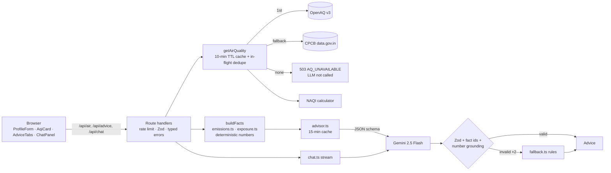

# SmogSense

**A GenAI air-quality assistant for Indian cities in winter smog. It is grounded on live OpenAQ / CPCB data and never on guesses.**

Built for PromptWars Virtual Challenge 6 (Google × Hack2skill).

**Live demo:** _<Cloud Run URL here>_

## Problem

Every winter, AQI in Delhi, Lucknow, Patna, Kolkata and many other cities goes past 300. Generic advice like "stay indoors" doesn't help people decide **when** to commute, **how** to keep a child's bedroom clean, or **which** greener choice actually matters. SmogSense turns the live station reading plus your household into a plan. Every recommendation says **why** and gives a concrete, computed **impact**.

## Features mapped to the problem statement

| PS requirement | Feature | Code |
|---|---|---|
| Real-time AQI only from public APIs | OpenAQ v3 (nearest fresh station), then CPCB/data.gov.in fallback. If neither answers, the UI shows "Live data unavailable" and the LLM is never called | `src/lib/aq/openaq.ts`, `src/lib/aq/cpcb.ts`, `src/lib/aq/index.ts` |
| Indian AQI | CPCB National AQI sub-indices and categories, plus the official health statements | `src/lib/aq/naqi.ts` |
| Low-emission daily routines | Commute mode exposure comparison, best outdoor window, N95 guidance, indoor exercise | `src/lib/impact/facts.ts` (routines) |
| Trip timing from live AQI | Outdoor window from the winter diurnal cycle combined with the live category (Severe → avoid exertion). Warns when your work start falls in the morning peak | `src/lib/ai/fallback.ts`, `facts.ts` |
| Indoor air hacks | Purifier (own / HEPA / DIY by budget), ventilation timing, cooking exhaust, indoor smoke, an honest note on plants | `facts.ts` (indoor) |
| Sustainable alternatives + impact | Transit switch, carpool, WFH day, active short trips, no open burning, each with kg CO₂/week or g PM2.5 | `src/lib/impact/emissions.ts` |
| Every item states WHY + IMPACT | Schema enforces `{action, why, impact, personalizedFor, priority}` | `src/lib/ai/schema.ts` |
| Personalisation | Location (city or GPS), kids, elderly, respiratory sensitivity, pets, commute mode and distance, work hours, purifier, budget | `src/lib/profile.ts`, `src/components/ProfileForm.tsx` |
| GenAI | Gemini 2.5 Flash personalises and prioritises with structured JSON. Streamed follow-up chat. English and Hindi | `src/lib/ai/advisor.ts`, `src/lib/ai/chat.ts` |

## Architecture



## Data sources

- **OpenAQ v3**: `/v3/locations?coordinates=…&radius=25000&limit=5`, then `/v3/locations/{id}/latest` for each candidate, in parallel. Units are normalised to µg/m³ (ppm/ppb are converted at 25 °C). Sensors more than 3 h older than the site's newest reading are ignored. The nearest fresh station wins.
- **CPCB real-time AQI** via data.gov.in resource `3b01bcb8-0b14-4abf-b6f2-c1bfd384ba69`, filtered by city. Uses the nearest station with PM data. Timestamps are parsed as IST.
- Readings older than 3 h are flagged **stale** in the UI.
- Impact factors are listed with their sources in `src/lib/constants.ts`: India GHG Program emission factors, Goel et al. 2015 (Delhi in-transit PM2.5), US EPA Exposure Factors Handbook, single-zone mass balance (Nazaroff 2004), Singer et al. 2012, Liu et al. 2003, Akagi et al. 2011, Cummings & Waring 2020.

## How the AI is grounded (no hallucinated AQI)

1. **No data, no AI.** `/api/advice` and `/api/chat` call `getAirQuality` first. If every source fails, they return 503 before any model call.
2. **Code computes, the LLM explains.** `buildFacts()` creates every recommendation with its impact number computed deterministically (kg CO₂, % exposure, purifier mass balance). Gemini only rephrases, personalises and prioritises these facts, and references each one by `factId`.
3. **The impact is always ours.** In English the computed `impact` string is used verbatim. A Hindi translation is accepted only if its numbers match the fact exactly.
4. **Number guard.** Any number in the model's summary, action or why text that doesn't appear in the grounded context causes the output to be rejected. It then retries once, and after that uses the rule-based fallback. The fallback works with zero AI.
5. **Chat** is grounded on the same snapshot and facts, which are fetched server-side and never accepted from the client. User text is delimited and capped at 500 chars.
6. **Plain text only.** Model output is never rendered as HTML.

## Judging criteria evidence

| Criterion | Evidence |
|---|---|
| **Code quality** | TypeScript `strict` + `noUncheckedIndexedAccess`, no `any` (lint rule set to error). One responsibility per file, every file under 200 lines, pure functions in `src/lib`, typed errors (`src/lib/errors.ts`), JSDoc on exports, every constant sourced in `src/lib/constants.ts`. ESLint runs with `--max-warnings 0` |
| **Security** | [SECURITY.md](SECURITY.md) threat model. `server-only` key modules, Zod env + body validation, lat/lon bounds, a 500-char chat cap, a 16 KB body cap, per-IP token bucket (429), CSP / XFO / nosniff / Referrer / Permissions-Policy / HSTS headers, no stack traces in responses, `npm audit` clean |
| **Efficiency** | AQ cache 10 min (keyed by lat/lon at 2 dp) and advice cache 15 min, both with in-flight dedupe (`src/lib/cache.ts`). Parallel station fetches, 5 s `AbortSignal` timeouts, `maxOutputTokens` caps, `thinkingBudget: 0`. Server Components by default, chat panel loaded with `next/dynamic`, streamed chat. SVG only, system fonts. 110 kB first-load JS, standalone output |
| **Testing** | Vitest: 124 tests across unit, integration and component suites. Coverage thresholds of 80% are enforced on `src/lib` (currently about 99% lines and 88% branches). Every NAQI category edge, the source fallback order, the stale flag, advisor retry → fallback, the hallucination guard, and each route's 200/400/429/503/500 path are covered. vitest-axe runs on the components. Playwright E2E covers onboarding → AQI → 3 tabs → chat, with axe WCAG 2.1 AA scans. CI runs all of it (`.github/workflows/ci.yml`) |
| **Accessibility** | `lang` attribute (plus `lang="hi"` on Hindi content), skip link, landmarks, a single h1 with ordered headings, labelled inputs, errors linked through `aria-describedby` and `aria-invalid`, WAI-ARIA tabs with arrow/Home/End keys, a visible focus ring, `aria-live` for the AQI card and streamed chat. The category is shown as text plus a distinct icon shape, not colour alone. 44 px targets, `prefers-reduced-motion` respected. Zero axe violations in unit and E2E tests |
| **Problem statement alignment** | See the feature table above: live public AQI only, the Indian NAQI, routines, timing, indoor hacks and alternatives, each with why, impact and personalisation, plus English/Hindi |

## Setup

```bash
npm ci
cp .env.example .env.local   # add OPENAQ_API_KEY, DATA_GOV_IN_API_KEY, GEMINI_API_KEY
npm run dev                  # http://localhost:3000
```

All keys are optional individually. You need at least one AQ key (OpenAQ or data.gov.in) for live data. Without `GEMINI_API_KEY`, the app serves rule-based advice and chat returns 503 `AI_UNAVAILABLE`.

## Test

```bash
npm run lint && npm run typecheck
npm run test:coverage        # unit + integration + component, thresholds enforced
npm run build && npx playwright install chromium && npm run test:e2e
```

## Deploy to Google Cloud Run

```bash
gcloud config set project YOUR_PROJECT
gcloud services enable run.googleapis.com cloudbuild.googleapis.com secretmanager.googleapis.com

# Store keys in Secret Manager (never in the image)
printf '%s' "$OPENAQ_API_KEY"      | gcloud secrets create openaq-key --data-file=-
printf '%s' "$DATA_GOV_IN_API_KEY" | gcloud secrets create datagov-key --data-file=-
printf '%s' "$GEMINI_API_KEY"      | gcloud secrets create gemini-key --data-file=-

gcloud run deploy smogsense \
  --source . \
  --region asia-south1 \
  --allow-unauthenticated \
  --memory 512Mi --max-instances 3 \
  --set-secrets OPENAQ_API_KEY=openaq-key:latest,DATA_GOV_IN_API_KEY=datagov-key:latest,GEMINI_API_KEY=gemini-key:latest
```

The Dockerfile is multi-stage, runs as a non-root user, and listens on `PORT=8080`. The Cloud Run service account needs `roles/secretmanager.secretAccessor` on the three secrets.
